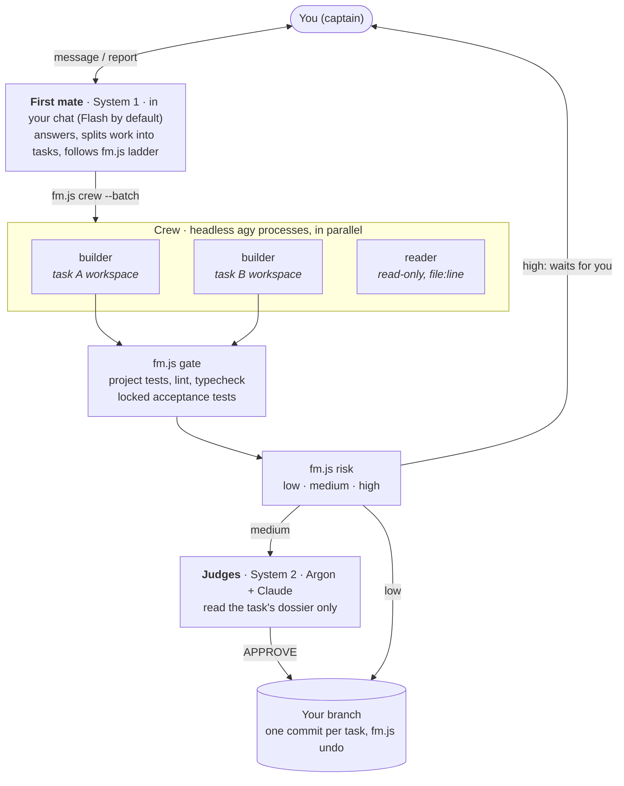

<p align="center">
  
</p>

<h1 align="center">firstmate</h1>

<p align="center">
  <b>One cheap brain in the chat. A whole crew in parallel. A strong judge only when it matters.</b><br>
  A plugin for Google Antigravity (IDE, App and CLI): a first mate splits your request into tasks, a Gemini Flash crew works on them in parallel, code gates every change, and what passes is merged with an undo.
</p>

<p align="center">
  <a href="https://www.youtube.com/watch?v=5EgJ6cQqRFo">
    
  </a><br>
  <sub>▶ <a href="https://www.youtube.com/watch?v=5EgJ6cQqRFo">The 90-second demo</a> shows v0.12; v1 works the same way with less waiting on you.</sub>
</p>

```bash
npx -y github:cuongtt0201/antigravity-firstmate
```

> **v1.0.0-alpha.8.** This is the first version built for the Antigravity IDE. See [What changed in v1](#what-changed-in-v1).

---

## Why firstmate

**Gemini Argon** reasons well, but a chat that runs on it rereads the whole conversation on every turn and burns through your quota. **Gemini Flash** is cheap and fast, but left alone it guesses, ships half a fix and makes claims it cannot back up.

firstmate puts each model where it pays off:

- **The first mate (System 1) runs in your chat on a cheap model.** It answers what is small and turns real work into tasks.
- **The crew runs in parallel, on Flash.** Each builder works in its own git worktree, outside your repo. Readers answer one question each, with `file:line` evidence. Hard tasks get an *arena*: three builders try three approaches.
- **Code decides what models should not.** It runs the gates (your project's typecheck, lint and test, plus Helm, Terraform, YAML and JSON checks). It classifies the risk of every change, and it decides the next step (`fm.js ladder`).
- **The judges (System 2) are Argon and Claude, called only when the risk calls for it.** Two model families judge in parallel, so one family's blind spot does not merge on its own; the most cautious verdict counts. They read a 30 KB dossier of the task, never your chat history.
- **You stay in charge of what matters.** Low-risk changes that pass are merged. Medium-risk ones are merged once both judges approve. High-risk ones wait for you. Every merge can be undone with one command.
- **It keeps working while you are away.** `/afk` queues your requests; a runner works through them, one fresh first-mate chat per request, one commit per task.

On one real task (fix a unicode bug against a locked test, with an arena and two judge calls), Argon used **12%** of the tokens. A v0.12 chat measured 44–57%. See [docs/benchmarks.md](docs/benchmarks.md).

## How it works



A change, as the first mate runs it:

1. **Tasks.** One task per independent part, so they run in parallel and merge cleanly: `fm.js start <repo> <task> --request "<your words>"`.
2. **Acceptance tests first** for medium- or high-risk work. A builder in the tester role writes them, `fm.js lock` freezes them, and the crew can no longer change them (the gate fails and the guard refuses).
3. **Crew.** `fm.js run <repo> --batch <file>` starts every task's builder at once as a headless `agy` process in its own workspace, and drives each task through steps 3 to 6 by itself: when a builder stops, fm.js records its work and runs the gate, sends failing lines (or the judges' fixes) back to the builder, asks the judges and delivers. The first mate makes one call for the whole change.
4. **Ladder.** `fm.js ladder <repo> <task>` reads the task's record and says what comes next: `fix` (send the failing lines back), `arena 3`, `judge`, `deliver`, or `ask captain`.
5. **Judges.** `fm.js judge` runs Argon and Claude in parallel on the task's dossier: request, done-when, risk, locked tests, gate lines, the diff with every unchanged caller. Each returns APPROVE, REVISE, REJECT or HUMAN; the most cautious one counts, and a disagreement is reported. If a judge fails, the verdict is HUMAN. `fm.js config <repo> judges '["strong"]'` keeps one judge.
6. **Deliver.** `fm.js deliver` merges the task the way the repo is set: `propose`, `apply` (uncommitted) or `commit` (one commit per task, trailer `Firstmate-Task:`). High risk stops with exit 3 until you say yes.
7. **Report.** `fm.js report` lists what was merged, what waits for you and why, and the crew's tokens with the strong model's share. `fm.js trust` shows how many merges you kept.

## What you can ask

Talk normally. In the IDE, start a chat with `/firstmate`. In the App or the CLI, pick the `firstmate` agent.

| You say | The first mate |
|---|---|
| "Which port does the API listen on?" | Reads up to three files itself and answers |
| "How does the upload flow work?" | Readers in parallel, one angle each, with `file:line` evidence |
| "The pod keeps restarting on prod" | Hypotheses, one reader each, and the fix as commands for you to run |
| "Add retry with backoff to the API client" | Tasks, builders in parallel, gates, the judge if needed, then a commit per task |
| "Write the case study" | `/best`: three drafts race and the winner is rewritten from scratch |
| "/afk: add the --json flag, then fix the unicode slugs" | Queues both, starts the runner, and tells you how to check when you are back |

## While you are away (/afk)

Type `/afk` with what you want done, or queue it yourself and start the runner in a terminal:

```bash
node ~/.gemini/config/plugins/flash-ultra/scripts/fm.js queue . add "Add a --json flag to cli.js" "Fix the unicode slugs"
node ~/.gemini/config/plugins/flash-ultra/scripts/fm.js afk . --detach
```

- Each request runs in **its own new first-mate chat** (`agy`, Flash), told that it runs unattended: no questions, only `fm.js` commands, high risk left for you. No chat grows long, so nothing is reread.
- The runner needs merge mode `commit` (`fm.js config . merge commit`), a branch that is not protected and a clean working tree, so every item starts from the commit the last one left. It stops if an item leaves uncommitted changes.
- When you are back: `fm.js queue .` (each item: done, failed, waiting, with its last line) and `fm.js report .` (commits, what waits for you, tokens). `fm.js undo . <task>` takes a commit back. `fm.js afk . --stop` stops after the current item.
- The runner gives each chat its own session permissions (fm.js, the brief folder, the task workspaces); `--grant` is not needed for it.

## Quota

Antigravity gives each account separate quota groups: Gemini (Flash, Pro), Gemini 4 Argon, and Claude and GPT, each with a five-hour and a weekly limit. Before anything runs, fm.js asks `agy` which models the account offers and what each group has left (`agy -p /usage`, no tokens), and acts on it:

| Group empty | What happens |
|---|---|
| Argon | Claude judges alone; the verdict says which judge was skipped and until when |
| Claude and GPT | Argon judges alone |
| Both judge groups | nothing runs (exit 4); the ladder says `wait for quota`, the task waits |
| Gemini | the crew does not start (exit 4); `/afk` waits for the group to come back (up to `afkMaxWaitHours`, 6) and goes on; an item cut short with nothing delivered goes back to the queue |

A model the account does not offer is skipped the same way. `fm.js quota` shows every group, what is left, when an empty one comes back and which roles it serves. A group with 2% or less left counts as empty (`quotaReserve`).

## Safe by default

The guard hook runs on every tool call of the first mate and the crew, in the IDE, the App and the CLI:

- **Core pack** (always on):
  - no `git push`;
  - no publishing (`npm publish`, `twine upload`, `docker push`…);
  - nothing that destroys your uncommitted work (`reset --hard`, `clean -f`, `checkout -- .`, `branch -D` in your checkout);
  - no secrets in a command line or written into a file (AWS keys, private keys, GitHub/Slack/Google tokens);
  - production database clients ask you first;
  - no package installs over the `node_modules` a workspace borrows from your checkout.
- **DevOps pack** (on by default, off with `fm.js config <repo> packs '["core"]'`): reads only for `kubectl`, `helm`, `terraform`, `gcloud`, `gsutil`; `ssh` asks.
- **Roles hold.** Readers and the judge cannot write. Builders cannot touch locked tests, gate results, notes, facts, settings or verdicts. Only the first mate decides, merges and starts more crew.
- **Crew permissions stay narrow.** Builders run in the CLI's `accept-edits` mode: file edits inside their workspace are approved, and shell commands are not. Readers and the judge run in the CLI's default mode and only read.
- **Task work goes through `fm.js crew`.** An in-chat builder briefed on a task workspace is refused, so every builder's work is recorded, saved and gated by code. In-chat builders remain for `/best` drafts.

The guard reads command text, so it is a safety net, not a sandbox.

## Requirements

- Google Antigravity: the IDE, the App, or the CLI.
- **The Antigravity CLI (`agy`)** for the crew: it runs headless crew processes. `node install.js --check` tells you if it is there.
- macOS, Linux or Windows, `git`, and **Node.js 22.13 or newer**.
- Optional, used when present: `helm`, `terraform` / `terragrunt`, `hadolint`, `python3`.

## Install

```bash
npx -y github:cuongtt0201/antigravity-firstmate
```

To check what your machine has without installing anything, add `--check`. Then:

1. **Restart Antigravity.** **Firstmate Crew** appears under Customizations → Plugins.
2. **IDE:** type `/firstmate` at the start of a chat. **App:** pick the **firstmate** agent; after every update re-select it (pick another agent, then firstmate), because the App keeps a snapshot of the selected agent.
3. **Once per repo**, the first mate runs `fm.js init` and `fm.js detect --write`, so your tests and linters become part of every gate. Choose how merges land with `fm.js config <repo> merge commit` (or `apply` / `propose`).
4. **Optional: let the first mate work without asking at every step.** Antigravity asks before each `fm.js` command and before reading the task workspaces in `~/.firstmate/wt`, which lie outside your repo; the headless CLI cannot ask, so it refuses. This adds exactly those two grants to Antigravity's global permissions (`--uninstall` takes them back):

   ```bash
   npx -y github:cuongtt0201/antigravity-firstmate --grant
   ```

   The guard still checks every command. To run the first mate headless once without the grants, pass them for that session only: `agy -p "<task>" --agent firstmate --settings '{"permissions":{"allow":["command(node <plugin>/scripts/fm.js)","read_file(<home>/.firstmate/wt)","write_file(<repo>/.firstmate/briefs)"]}}'` (`<plugin>` is `~/.gemini/config/plugins/flash-ultra`, written out in full).

To remove it:

```bash
npx -y github:cuongtt0201/antigravity-firstmate --uninstall
```

## What changed in v1

| v0.12 | v1 |
|---|---|
| Argon was the main agent and reread the whole chat on every turn | The first mate runs on Flash; Argon is the judge, called with a dossier |
| Fixed playbooks (quick, how, investigate, change) and checklists on every reply | The first mate decides; code decides the gates, the risk and the next step (`fm.js ladder`) |
| In-chat subagents only (App) | The crew runs as headless `agy` processes, so it works in the IDE, the App and the CLI |
| Explorer, worker, checker | Reader, builder, judge, each with the role the first mate writes in the brief |
| Every change waited for "go" and landed uncommitted | Merged by risk: low passes, medium needs APPROVE, high waits; one commit per task; `fm.js undo` |
| Workspaces in `<repo>/.firstmate/wt` | Workspaces in `~/.firstmate/wt/<repo>-<hash>/`, each with its own port slot (`FIRSTMATE_SLOT`, `PORT`) |
| Syntax checks | Your project's typecheck, lint and test in every gate, plus locked acceptance tests |
| One worker reused across tasks | A fresh builder for every task; the arena for hard ones |

Tasks started under v0.12 inside the repo still work. `fm.js clean <repo> --legacy` lists worker branches that old versions left behind, and removes them with `--yes`.

## Known limitations

- **Alpha.** The full flow ran end to end on real tasks, driven by hand and by the first mate itself in the CLI (see benchmarks). Larger runs are still to come.
- Without `--grant`, the headless CLI refuses the first mate's first `fm.js` command (see Install, step 4).
- In the IDE, the plugin's `SessionStart` and `PreInvocation` hooks are not confirmed yet. The guard runs. `tools/probe/` and [docs/ide-capabilities.md](docs/ide-capabilities.md) describe how to check the rest.
- Headless crew runs end when the CLI refuses a command, so builders edit with file tools only and fm.js runs the checks after them.
- The crew is all Gemini; only the second judge is of another family. Both judges are models of your own Antigravity account (Gemini 4 Argon and Claude Sonnet, as in its model list), run through `agy`; nothing else is needed.
- `fm.js review` finds uses of changed names with `git grep`; calls through variables or reflection are not listed.
- Prompt rules guide the models; only the hooks and scripts enforce.

## Contributing

Edit files under `plugin/`. Run `npm test` (git, node and bash are required; on Windows, Git Bash works). Reinstall with `node install.js`, then try the change. The v1 design and plan are in `docs/superpowers/`. Issues and PRs are welcome.

## License

MIT
