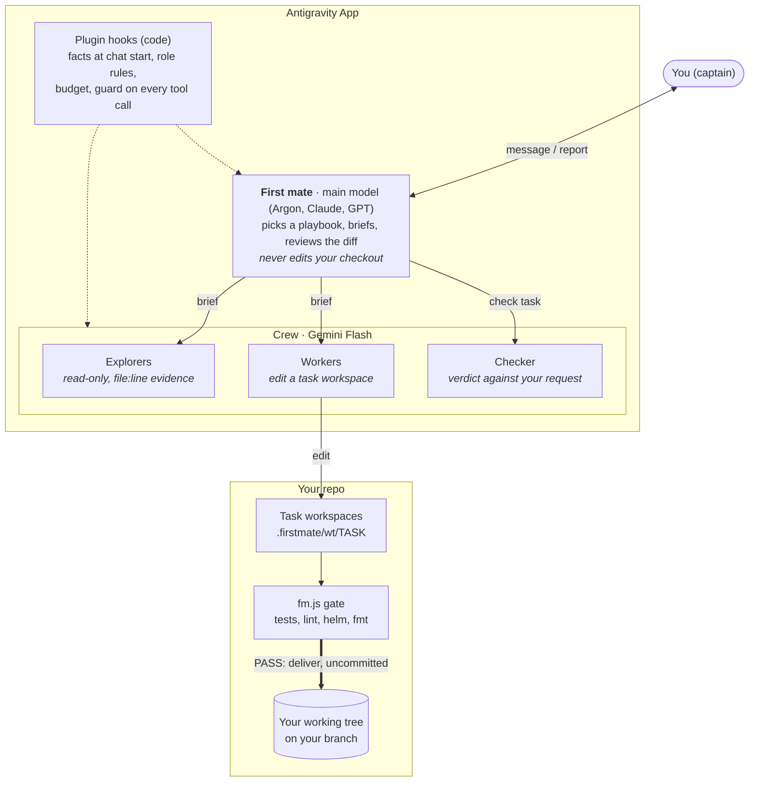

<p align="center">
  
</p>

<h1 align="center">firstmate</h1>

<p align="center">
  <b>One brain. A whole crew.</b><br>
  A plugin for the Google Antigravity App: a strong model leads, a crew of Gemini Flash agents does the work, and code checks every change before it reaches you.
</p>

<p align="center">
  <a href="https://www.youtube.com/watch?v=5EgJ6cQqRFo">
    
  </a><br>
  <sub>▶ <a href="https://www.youtube.com/watch?v=5EgJ6cQqRFo">Watch the 90-second demo</a>: from an empty folder to a shipped docs chatbot.</sub>
</p>

```bash
npx -y github:cuongtt0201/antigravity-firstmate
```

---

## Why firstmate

A big model like **Gemini Argon** reasons well, but when it reads everything itself it burns through your quota. **Gemini Flash** is cheap and fast, but left alone it guesses at project context, ships half a fix and makes claims it cannot back up.

firstmate gives the big model a crew:

- **The first mate decides.** Your main model (Argon by default, or Claude or GPT) plans, writes briefs for the crew and judges the work from the diff, not from the crew's description of it.
- **Flash does the work.** Explorers read, workers edit, a checker tries to break the result. They work in parallel, each with its own rules and report format.
- **Code checks what models cannot be trusted to check.** Hooks enforce the safety rules; scripts run the gates (tests, lint, `helm template`, `terraform fmt`, word limits) before anything reaches you.
- **You stay in charge.** Every change arrives in your working tree as uncommitted edits. You commit and push. Agents are blocked from applying, deleting, scaling or pushing.

## What the demo shows

| Day | You ask | firstmate |
|---|---|---|
| 0 | Start a project in an empty folder | Asks before it creates a git repo |
| 1 | Build a support chatbot in four parts | Four workers build in parallel, each in its own worktree. Tests gate every part, the first mate reads the diffs and catches what one worker cannot see, a checker tries to break it. Then you commit. |
| 2 | Keep going in a new chat | Still remembers your stack from `.firstmate/facts.md`. Workers search the web and use your installed skills. |
| 3 | "The answers cite the wrong pages" | Three explorers check three leads at once and report the cause with `file:line` evidence |
| 4 | Write the README and landing page | `/best`: three drafts race, a length gate and scorecards pick the winner, and the final is rewritten from scratch |

## What you can ask

Talk normally; the first mate picks a playbook and names it on the first line of its reply. `/how`, `/investigate`, `/change` and `/best` force one.

| Playbook | For example | What you get |
|---|---|---|
| **quick** | "Which port does the API listen on?" | A short answer with the why, no subagents |
| **how** | "Where does this upload go?", "What changes if we switch providers?" | 1 to 4 explorers in parallel: an overview, `file:line` evidence, the smallest change, gotchas and unknowns |
| **investigate** | "The api-gateway pod keeps restarting on prod. Find the cause." | The cause and how sure it is, the evidence, and the fix as commands for you to run |
| **change** | "Add an alert when a pod restarts 3 times in 10 minutes" | A plan that waits for your go, then a gated, checked change in your working tree, uncommitted |
| **best** | A report, case study, proposal, or hard code | Three independent drafts, scorecards, a judged winner, and a rewrite from scratch |

## How it works



A change goes through eight steps:

1. **Route.** The first mate names a playbook and copies its steps as a checklist.
2. **Read.** Small questions it answers itself, within 6 reads per message. Larger ones go to explorers, one angle each, always including error paths and security when the goal is a change.
3. **Plan and wait.** It proposes the smallest change that reaches the goal and stops until you say go.
4. **Work apart.** Workers edit detached worktrees, never your checkout, one worker per task.
5. **Gate.** Each worker runs the checks that match its files and fixes until PASS, at most 3 gates. Nothing that has not passed can be delivered.
6. **Review.** The first mate reads the diff, every place the changed names are used, related files left unchanged (other environments, tests), and a checklist for the kinds of files touched.
7. **Verify.** It writes 3 to 5 scenarios aimed at what is most likely to break. A checker runs them, adds its own adversarial inputs, and compares the result with your original words.
8. **Deliver.** The diff lands in your working tree, uncommitted, with the gate line, the scenario results, the checker's verdict and the commands you run next.

The full component list, workspace model, guard table and token chart are in [docs/architecture.md](docs/architecture.md).

## Safe by default

- **Your branches stay yours.** Task workspaces live under `.firstmate/wt/`, tracked by `refs/firstmate/*`. They never show up in `git branch` and are never pushed. `.firstmate/` is hidden through `.git/info/exclude`; your `.gitignore` is not changed and nothing is committed for you.
- **No live changes.** Reads run (`kubectl get/describe/logs`, `git log/diff`, `helm template`, `terraform plan`, `gcloud … list`). Everything that changes a cluster, cloud or remote is refused for you to run yourself: `kubectl apply/delete/scale/exec…`, `helm install/upgrade`, `terraform apply/destroy`, `gcloud … create/delete`, writes to `gs://`, `git push`. `ssh` and `scp` ask you first.
- **MCP tools:** reads run, anything else asks you first; explorers cannot call them at all.
- **Limits:** the first mate is told to send explorers after 6 direct reads and is stopped at 15; at most 12 subagents per chat per day; workers and checkers are pinned to Flash.
- **Guardrails stay put.** The crew cannot write gate results, notes or facts itself, and the installed plugin is read-only so agents cannot edit their own rules.

The guard reads command text, so it is a safety net, not a sandbox.

## Requirements

- The Antigravity **App** (the IDE has no subagents), with a strong main model for the first mate: **Gemini 4 Argon**, Claude or GPT.
- macOS, Linux or Windows, and `git`.
- **Node.js 22.13 or newer.** The hooks use `node:sqlite`; the installer refuses an older Node, because hooks that cannot run would let everything through.
- Optional, used when present: `helm`, `terraform` / `terragrunt`, `hadolint`, `python3`.

## Install

```bash
npx -y github:cuongtt0201/antigravity-firstmate
```

To pin this release: `npx -y github:cuongtt0201/antigravity-firstmate#v0.12.0`. To see what your machine has and lacks without installing anything: add `--check`.

The installer copies `plugin/` to `~/.gemini/config/plugins/flash-ultra/`, fills in the paths for your machine, enables the plugin in `~/.gemini/config/config.json` (after backing it up) and makes the installed copy read-only. Running it again updates the plugin.

Then:

1. **Turn off Terminal Sandbox** in Settings. With it on, workers cannot run `git`, `helm` or package installs inside task workspaces.
2. **Restart the App.** **Firstmate Crew** appears under Customizations → Plugins.
3. Open a chat in **Local** mode, pick the **firstmate** agent and the model that should judge the work, and talk normally. The crew always runs on Flash. One-off questions are cheaper in a plain Flash chat.
4. **After every install or update, re-select the agent** (pick another agent, then firstmate). The App keeps a snapshot of the selected agent and uses it for new chats until you re-select; restarting does not refresh it.

To remove it:

```bash
npx -y github:cuongtt0201/antigravity-firstmate --uninstall
```

## Known limitations

- Windows support is new: tested in CI, not yet in long daily use. On Windows the hooks call `node` from PATH.
- Only the first mate has a budget. Open-ended work such as tuning a model until a score improves can run for thousands of steps (one worker ran over 2,000). Give such requests a stop condition: a target, a number of experiments, or a time.
- In the Antigravity CLI (`agy`) 1.4.6 on Windows, terminal commands took about 12 minutes to return while the plugin was enabled. Use 1.4.7 or newer.
- The gate checks syntax and rendering, not behaviour. Review the diff as you would any PR.
- `fm.js review` finds uses of a changed name with `git grep`, so calls through variables, reflection or built-up names are not listed.
- Charts vendored as git submodules render only if they are checked out in your clone; otherwise the gate reports SKIP.
- Prompt rules guide the models but are not enforced; only the hooks and scripts are.

## Contributing

Edit files under `plugin/`, run `npm test` (needs git, node and bash; Git Bash works on Windows), reinstall with `node install.js`, re-select the agent, and try the change in the App. Issues and PRs are welcome.

## License

MIT
