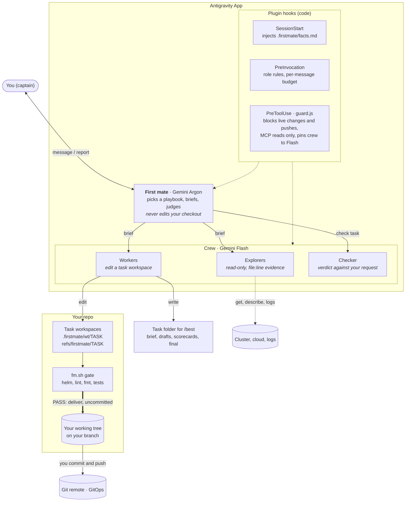
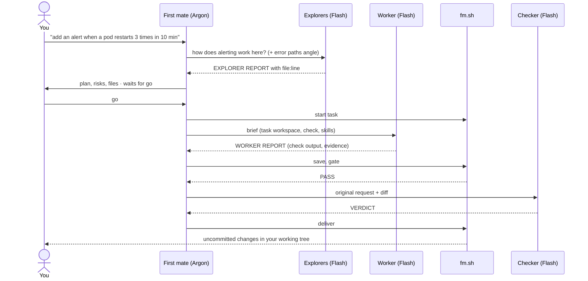

# antigravity-firstmate

A plugin for the **Google Antigravity App** that lets **Gemini Argon** run a crew of **Gemini Flash** subagents for everyday engineering work: reading code, chasing incidents, changing config, IaC, CI and code, and writing reports.

## Why

Argon reasons well but burns through its quota. Flash is cheap and fast, but left alone it guesses at project context, ships partial fixes and makes confident claims it cannot back up. Neither should be trusted with your branches or your live systems.

Firstmate splits the work so each piece goes where it is cheapest and safest:

- **Argon decides.** The first mate routes each message to a playbook, writes briefs, and judges the crew's evidence. It answers small questions itself, within a budget of 6 reads per message; bulk reading goes to the crew.
- **Flash does the work.** Explorers read, workers edit, a checker verifies. Each role has its own rules and a fixed report format, so the first mate reads short reports instead of raw files.
- **Code checks what models cannot be trusted to check.** Hooks enforce the safety rules and the budget; scripts run the gates (`helm template`, lint, `terraform fmt`, tests, word limits) before anything reaches you.
- **You stay in charge.** Changes arrive in your working tree as uncommitted edits. You commit, push and apply. Agents are blocked from applying, deleting, scaling or pushing.

## Architecture



| Part | Model | Can write | Job |
|---|---|---|---|
| First mate (`agents/firstmate.md`) | Gemini Argon | Its notes only | Route, brief, judge evidence, deliver |
| Explorer (`agents/explorer.md`) | Gemini Flash | Nothing | Read one angle; report findings with `file:line` and measured / inferred / guess labels |
| Worker (`agents/worker.md`) | Gemini Flash | Its task workspace | Make one change or write one draft; report the check it ran |
| Checker (`agents/checker.md`) | Gemini Flash | Nothing | Compare the result with your original request; tests and adversarial inputs for code, impact for config, a scorecard for documents |
| `hooks/guard.js` | n/a | n/a | Safety policy and the first mate's budget, on every tool call |
| `hooks/inject.js` | n/a | n/a | Facts at chat start, each role's rules before every model turn |
| `scripts/fm.sh` | n/a | Task worktrees | The model's own workspace and the gates |

## How a request flows

1. **Route.** The first mate names a playbook on the first line of its reply and copies the playbook's steps as a checklist. `/how`, `/investigate`, `/change` and `/best` force one.
2. **Read.** Small questions: the first mate reads a few files itself. Larger ones: explorers read in parallel, one angle each, and always one angle on error paths and security when the goal is a change.
3. **Plan and wait.** For a change, the first mate proposes the smallest change that reaches the goal and stops until you say go.
4. **Work in its own space.** Workers edit a detached worktree, never your checkout.
5. **Gate.** `fm.sh gate` runs the checks that match the changed files. A failure goes back to the same worker, at most twice.
6. **Verify.** A checker compares the result with your original words, not with the plan.
7. **Deliver.** The diff lands in your working tree, uncommitted, with the gate output, the checker's verdict and the commands you run next.



### Playbooks

| Playbook | For | What you get |
|---|---|---|
| **quick** | a lookup that one command or a few small files answer | A short answer with the why, no subagents |
| **how** | "where does this upload go", "what changes if we switch providers" | 1 to 4 explorers in parallel; overview, `file:line`, the smallest change, gotchas, unknowns |
| **investigate** | a restarting pod, an alert, a pipeline that won't trigger | Cause and confidence, the evidence lines, and the fix as commands for you to run |
| **change** | Helm values, alert rules, CI files, Terraform, scripts, code | A plan, then (after your go) a gated, checked change in your working tree, uncommitted |
| **best** | a written deliverable (report, case study, proposal) or hard code | Three independent drafts, a length gate, scorecards, a judged winner, a rewrite from scratch |

### `/best` for written deliverables

1. **Clarify** the deliverables, format, language, length and rubric with one question.
2. **Brief** with numbered requirements copied from the source and one `deliverable:` line per output (`deliverable: final.md words=2500 covers=R1-R10 drafts=draft_*.md`).
3. **Draft** three versions in parallel, each from a different angle taken from the source. Workers write one section at a time and measure as they go.
4. **Shape gate.** `fm.sh shape` counts words per file against the brief's limits; a draft more than 10% over cannot win.
5. **Check and judge.** A checker scores each draft against the source; the first mate decides in a fixed order (length, unsourced facts, coverage, tone, strengths) and records each decision as `kept | revised | dropped -> what -> evidence`.
6. **Rewrite** the final from scratch, then the remaining deliverables from the final, and check again.

## Requirements

- The Antigravity **App** (the IDE has no subagents), with **Gemini 4 Argon** for the main agent.
- macOS or Linux, `bash`, `git`.
- **Node.js 22.13 or newer.** The hooks use `node:sqlite`; the installer refuses an older Node, because hooks that cannot run would let everything through.
- Optional, used when present: `ruby` (YAML and helmfile checks), `helm`, `helmfile`, `terraform` / `terragrunt`.

## Install

```bash
npx -y github:cuongtt0201/antigravity-firstmate
```

To try the current beta instead: `npx -y github:cuongtt0201/antigravity-firstmate#v0.10.0-beta.1`.

The installer copies `plugin/` to `~/.gemini/config/plugins/flash-ultra/`, fills in the absolute paths for your machine, enables the plugin in `~/.gemini/config/config.json` (after backing it up) and makes the installed copy read-only, so agents cannot edit their own guardrails. Running it again updates the plugin; the previous copy is backed up to your temp folder.

To remove it:

```bash
npx -y github:cuongtt0201/antigravity-firstmate --uninstall
```

## Setup

1. **Turn off Terminal Sandbox** in Settings. With it on, workers cannot run `git`, `helm` or package installs inside task workspaces.
2. Restart the App. **Firstmate Crew** should appear under Customizations → Plugins.
3. Open a chat in **Local** mode, pick the **firstmate** agent with **Gemini 4 Argon**, and talk normally. One-off questions are cheaper in a plain Flash chat.
4. **After every install or update, re-select the agent** in the agent picker (pick another agent, then firstmate). The App keeps a snapshot of the selected agent's prompt and tools and uses it for new chats until you re-select; restarting does not refresh it.

## Your branches stay yours

- Task workspaces are detached worktrees under `.firstmate/wt/`, tracked by `refs/firstmate/*`. They never show up in `git branch` and are never pushed.
- `.firstmate/` is hidden through `.git/info/exclude`, which exists only on your machine. The shared `.gitignore` is not changed, and nothing is committed for you.
- A finished change is applied to your working tree, uncommitted. If you have unsaved edits in the same files, delivery stops and tells you; if it cannot apply cleanly, the task is kept.
- Git-ignored `node_modules`, `.venv` and `.env` are linked into task workspaces so tests run there; they are never saved into a task.
- `.firstmate/facts.md` keeps what the first mate learned about the repo. When you correct it, it writes the fact down so the next chat does not repeat the mistake.

## Safety

The guard hook runs on every tool call while the plugin is enabled:

- **Allowed:** reading (`kubectl get/describe/logs/top`, `git log/diff`, `helm template`, `terraform plan`, `gcloud … list`), downloads from buckets.
- **Denied, you run it:** `kubectl apply/delete/patch/scale/rollout restart/drain…`, `helm install/upgrade/uninstall`, `helmfile apply/sync`, `terraform/terragrunt apply/destroy/import/state rm`, `gcloud … create/delete/update`, writes to `gs://`, `git push`.
- **Asks you first:** `kubectl exec` into prod pods, `kubectl cp/debug/run`, `ssh`, `scp`.
- **MCP tools:** reads (get, list, read, search, describe, … and `*_read_only`) run; anything else asks you first; explorers cannot call it at all.
- **Budget:** at most 6 direct reads or command segments per message for the first mate (its facts, notes, playbooks and `fm.sh` are free); after that it must send explorers.
- **Also:** explorers cannot write, workers and checkers are pinned to Flash, at most 12 subagents per chat per day, repeated reads of an unchanged file are stopped, and agents cannot edit the plugin.

The guard reads command text, so it is a safety net, not a sandbox.

## What's inside

| Path | Purpose |
|---|---|
| `agents/` | `firstmate`, `explorer`, `worker`, `checker`: prompts, tools and report formats |
| `skills/firstmate/playbooks/` | quick, how, investigate, change: the steps the first mate copies as its checklist |
| `skills/how`, `skills/investigate`, `skills/change`, `skills/best` | The commands that force a playbook; `/best` holds the drafting process |
| `rules/AGENTS.md` | Always on: calm tone, no invented facts, never change live systems |
| `hooks/guard.js`, `hooks/inject.js`, `hooks/lib.js` | Safety policy and budget; facts and role rules |
| `scripts/fm.sh` | `init`, `fact`, `start`, `save`, `gate`, `deliver`, `status`, `clean`, and `shape` for word limits |
| `scripts/fm-checks.sh`, `scripts/fm-helmfile.rb` | Checks picked from the changed files, including `helm template` for helmfile releases |

More detail (workspace model, full guard table, token chart) is in [docs/architecture.md](docs/architecture.md).

## Benchmarks

Not published yet. A comparison of Flash-only, Argon-only and Firstmate on a fixed set of tasks (a how question, an incident, a Helm change, a written case study) is planned.

## Known limitations

- macOS and Linux only for now; Windows needs path fixes in the installer and the guard.
- The gate checks syntax and rendering, not behaviour. Review the diff as you would any PR.
- Charts vendored as git submodules render only if they are checked out in your clone; otherwise the gate reports SKIP.
- Prompt rules guide the models but are not enforced; only the hooks and scripts are.

## Contributing

Edit files under `plugin/`, run `npm test` (guard policy, budget, context hooks, `fm.sh` workspace and `shape`; needs git, node and ruby), reinstall with `node install.js`, re-select the agent, and try the change in the App. Issues and PRs are welcome.

## License

MIT
