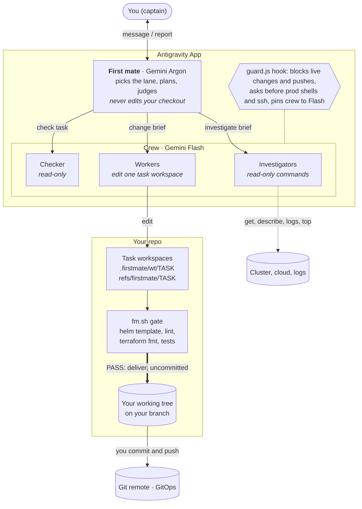

# antigravity-firstmate

A plugin for the **Google Antigravity App** that lets **Gemini Argon** run a crew of **Gemini Flash** subagents for everyday repo work: reading code, chasing incidents, and changing config, IaC, CI and code.

Argon is strong but uses up its quota quickly. Flash is cheap, but left alone it guesses at project context, ships small fixes, and makes confident claims it can't back up. The plugin puts each model where it is good, and puts code where neither should be trusted:

- **First mate (Argon)** reads your message, picks a lane, plans and judges. It never edits your checkout.
- **Flash workers** run the read-only commands of an investigation, or make a change in the model's own task workspace.
- **Code checks the change** (`helm template`, lint, `terraform fmt`, your tests) before anything reaches you, and a Flash **checker** reviews bigger changes against your original request.
- **You stay in charge of git and the live systems.** Changes arrive in your working tree as uncommitted edits; you commit, push and apply. A guard hook blocks agents from applying, deleting, scaling or pushing.

## How it works



Every message lands in one of three lanes. The first mate names the lane on the first line of its reply; `/investigate` and `/change` force one.

| Lane | For | What you get |
|---|---|---|
| **ask** | "lệnh nào để…", "luồng này chạy sao" | A short answer with the why |
| **investigate** | a pod restarting, an alert, a pipeline that won't trigger, a failing API call | Cause and confidence, the evidence lines, and the fix as commands for you to run |
| **change** | Helm values, alert rules, `.gitlab-ci.yml`, Terraform, scripts, code | A plan, then (after your go) a checked change in your working tree, uncommitted |

The sequence of a change, the workspace model and the full guard table are in [docs/architecture.md](docs/architecture.md).

## Install

Requires the Antigravity **App** (the IDE has no subagents), Node.js 18+, `git` and `bash`. `helm`, `terraform`/`terragrunt` and `ruby` (for YAML and helmfile checks) are used when present.

```bash
npx -y github:cuongtt0201/antigravity-firstmate
```

Restart the Antigravity App. **Firstmate Crew** should appear under Customizations → Plugins. To update, run the same command again (the previous copy is backed up to your temp folder). To remove it:

```bash
npx -y github:cuongtt0201/antigravity-firstmate --uninstall
```

The installer copies `plugin/` to `~/.gemini/config/plugins/flash-ultra/`, fills in the absolute paths for your machine, enables the plugin in `~/.gemini/config/config.json` (after backing it up) and makes the installed copy read-only, so agents cannot edit their own guardrails.

## Setup

1. **Turn off Terminal Sandbox** in Settings. With it on, workers cannot run `git`, `helm` or package installs inside task workspaces.
2. Open a chat in **Local** mode, pick the **firstmate** agent with **Gemini 4 Argon**, and talk normally. Quick one-off questions are cheaper in a plain Flash chat.

## Your branches stay yours

The model works in its own space inside your repo and never touches your branches:

- Task workspaces are detached worktrees under `.firstmate/wt/`, tracked by `refs/firstmate/*`. They never show up in `git branch` and are never pushed.
- `.firstmate/` is hidden through `.git/info/exclude`, which exists only on your machine. The shared `.gitignore` is not changed, and nothing is committed for you.
- A finished change is applied to your working tree, uncommitted. If you have unsaved edits in the same files, delivery stops and tells you.
- `.firstmate/facts.md` keeps what the first mate learned about the repo (which services are Node, what has tracing, environments). When you correct it, it writes the fact down so the next chat does not repeat the mistake.

## Safety

The guard hook runs on every tool call while the plugin is enabled:

- **Allowed:** reading (`kubectl get/describe/logs/top`, `git log/diff`, `helm template`, `terraform plan`, `gcloud … list`), downloads from buckets.
- **Denied, you run it:** `kubectl apply/delete/patch/scale/rollout restart/drain…`, `helm install/upgrade/uninstall`, `helmfile apply/sync`, `terraform/terragrunt apply/destroy/import/state rm`, `gcloud … create/delete/update`, writes to `gs://`, `git push`.
- **Asks you first:** `kubectl exec` into prod pods, `kubectl cp/debug/run`, `ssh`, `scp`.
- Also: worker and checker are pinned to Flash, at most 12 subagents per chat per day, repeated reads of the same file are stopped, and agents cannot edit the plugin.

It reads command text, so it is a safety net, not a sandbox.

## What's inside

| Path | Purpose |
|---|---|
| `agents/firstmate.md` | Main agent (Argon): lanes, hard rules, investigate and change flows |
| `agents/worker.md` | Flash worker; inherits installed skills, plugins and MCP servers; has web search |
| `agents/checker.md` | Flash checker, read-only; code mode (tests, adversarial inputs) and config mode (impact, unknown keys) |
| `skills/firstmate`, `skills/investigate`, `skills/change` | `/firstmate`, and the two commands that force a lane |
| `skills/best` | `/best`: three independent drafts, scored, rewritten from the winner |
| `rules/AGENTS.md` | Always on: calm tone, no invented facts, never change live systems |
| `hooks/guard.js` | The guard described above |
| `scripts/fm.sh` | The model's workspace: `init`, `start`, `save`, `gate`, `deliver`, `status`, `clean` |
| `scripts/fm-checks.sh`, `scripts/fm-helmfile.rb` | Automatic checks picked from the changed files, including `helm template` for helmfile releases with local charts |

## Early results

From the author's machine on Antigravity App 2.24, over a handful of runs with the earlier merge-based flow. Read them as indications, not benchmarks.

- **Small coding task** (`slugify` plus tests): about 12 minutes; the checker passed it with 18/18 adversarial inputs; Argon used about 20–24% of the tokens ([breakdown](docs/architecture.md#where-the-tokens-go)).
- **Parallel workers in worktrees** (`slugify_unique`, `slugify_many`): each worker built and committed in its own worktree, 31/31 tests passing.
- **`/best` on a coding task**: the final version passed 20/20 hidden tests.
- **ML competition planning** (analysis only): rubric score rose from 20.5/25 to 22/25 once workers could search the web; Argon used about 13–16% of the tokens.

## Known limitations

- macOS and Linux only for now; Windows needs path fixes in the installer and the guard.
- The gate checks syntax and rendering, not behaviour. Review the diff as you would any PR.
- Charts vendored as git submodules render only if they are checked out in your own clone; otherwise the gate reports SKIP.

## Contributing

Edit files under `plugin/`, reinstall with `node install.js`, and try the change in the App. Issues and PRs are welcome.

## License

MIT
