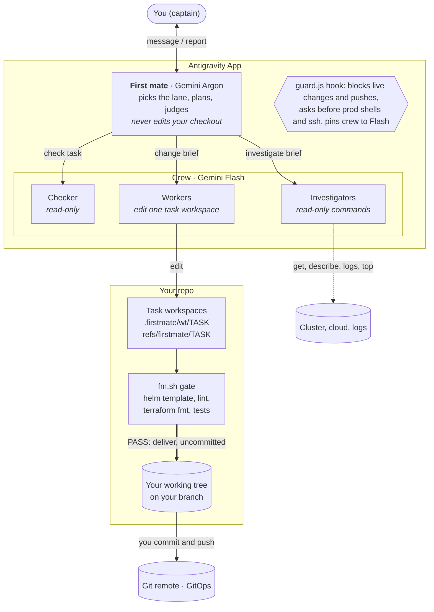
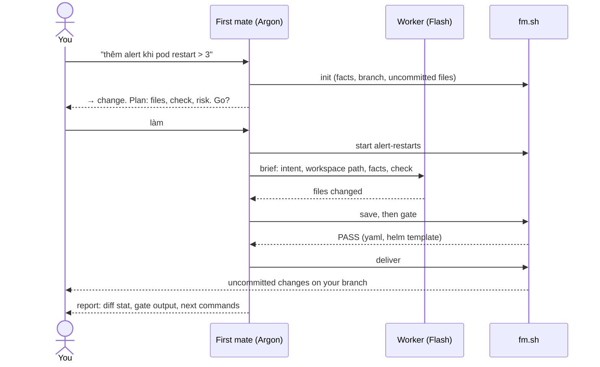
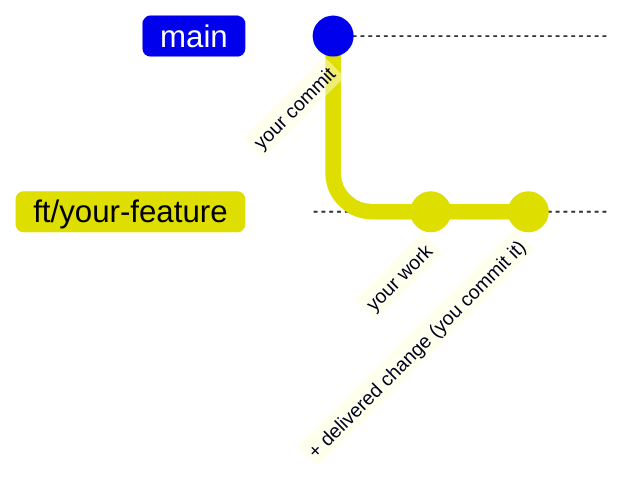
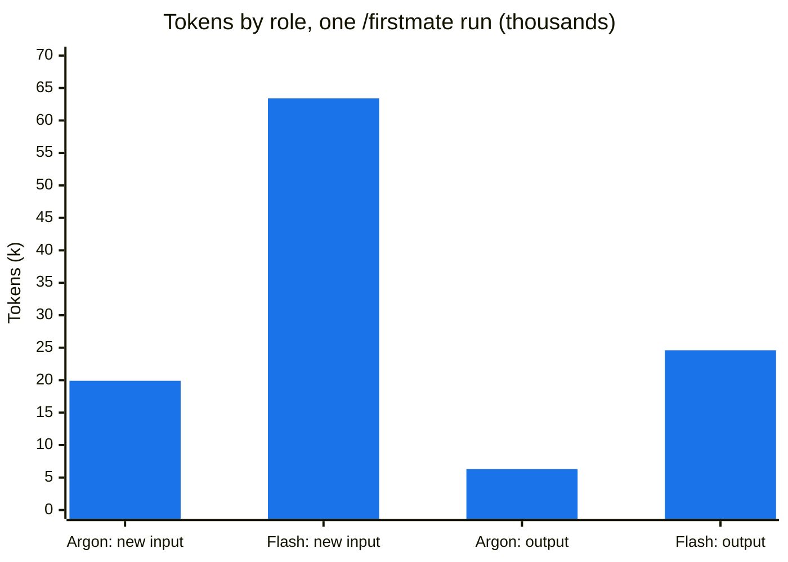

# Architecture

How the Firstmate Crew plugin is put together, and what happens when you ask it something.

## Components

| Part | Model | Writes | Job |
|---|---|---|---|
| First mate (`agents/firstmate.md`) | Gemini Argon | `.firstmate/facts.md`, notes | Pick the lane, plan, brief workers, judge evidence and scorecards, deliver |
| Worker (`agents/worker.md`) | Gemini Flash | Only its task workspace, or nothing when investigating | Run commands, read code, make one change |
| Checker (`agents/checker.md`) | Gemini Flash | Nothing | Compare a change with the original request; for code, run tests and adversarial inputs; for config, list impact and unknown keys |
| `scripts/fm.sh` | n/a | Task worktrees and `refs/firstmate/*` | The model's own workspace: init, start, save, gate, deliver, status, clean |
| `hooks/guard.js` | n/a | n/a | PreToolUse hook on every tool call (see Safety) |

## The three lanes

The first mate reads each message and starts its reply with the lane it picked. `/investigate` and `/change` force one.

| Lane | Typical request | What happens |
|---|---|---|
| **ask** | "lệnh nào để kéo file từ bucket", "luồng chatbot này chạy sao" | Answered directly, with a short why. At most one read-only worker when reading is needed. |
| **investigate** | "pod prod-core-insurance bị gì", "sao pipeline không trigger" | Hypotheses → read-only workers in parallel → evidence → cause, confidence and fix commands for you. Remote hosts and prod shells: you run the commands and paste the output. |
| **change** | "tăng retention tempo", "thêm alert rule", "sửa .gitlab-ci.yml" | Plan → wait for your go → worker edits a task workspace → `fm.sh gate` → checker for bigger changes → delivered to your working tree, uncommitted. |

## Workspace model: the model's branches stay out of yours

- A task is a **detached worktree** in `<repo>/.firstmate/wt/<task>`. Its commits are kept in `refs/firstmate/<task>/{base,head}`, not in `refs/heads`, so `git branch` never shows them and `git push` never sends them.
- `.firstmate/` is hidden through `.git/info/exclude`, which exists only on your machine. The shared `.gitignore` is never touched, and `fm.sh` never commits in an existing repo.
- `deliver` applies the task's diff to your working tree as **uncommitted** changes. It refuses if you have uncommitted edits in the same files, and uses a 3-way apply if your branch moved since the task started. You review `git diff`, then commit, push and open the MR as usual. Your history contains only your commits.
- Git-ignored `node_modules`, `.venv`, `vendor` and `.env` files are linked into each task workspace from your checkout, so builds and tests run; the links are excluded by exact path and never saved. Files a check leaves behind are removed after the gate.
- If your branch moved and the 3-way apply conflicts, the files are left with conflict markers and the task is kept; if the diff cannot be applied at all, nothing is changed and the task is kept.
- Charts vendored as git submodules are not checked out in task workspaces; the gate renders them from your checkout when they are there, and reports SKIP when they are not.

## Safety: what the guard does on every tool call

| Command | Decision |
|---|---|
| `kubectl get/describe/logs/top/events`, `git log/diff/show/status`, `helm template/lint/get`, `helmfile diff`, `terraform/terragrunt plan`, `gcloud … list/describe`, downloads from buckets | allowed |
| `kubectl apply/create/delete/edit/patch/replace/scale/set/label/annotate/drain/cordon/taint`, `kubectl rollout` (except status/history) | denied: you run it |
| `helm install/upgrade/uninstall/rollback`, `helmfile apply/sync/destroy` | denied |
| `terraform/terragrunt/tofu apply/destroy/import/taint/force-unlock`, `state rm/mv/push` | denied |
| `gcloud … create/delete/update/deploy/resize/…iam…`, `gsutil rm/mv`, uploads and syncs to `gs://` | denied |
| `git push` | denied |
| `kubectl exec` into anything named prod, `kubectl cp/debug/run/attach`, `ssh`, `scp`, remote `rsync`, `gcloud compute ssh` | asks you every time |
| Edits to the plugin or the hook config | denied |
| More than 12 subagents in one chat per day | denied until you say so |

The guard reads command text, so it is a safety net and not a sandbox: an obfuscated command can get past it. It applies to every chat while the plugin is enabled.

## Where the tokens go

Measured on a single small run (`slugify` plus tests, with the earlier merge-based flow) on the author's machine. Treat it as an illustration, not a benchmark. Argon tokens cost more and count against a separate quota, so the share that matters is Argon's: about 24% of new input and 20% of output.

