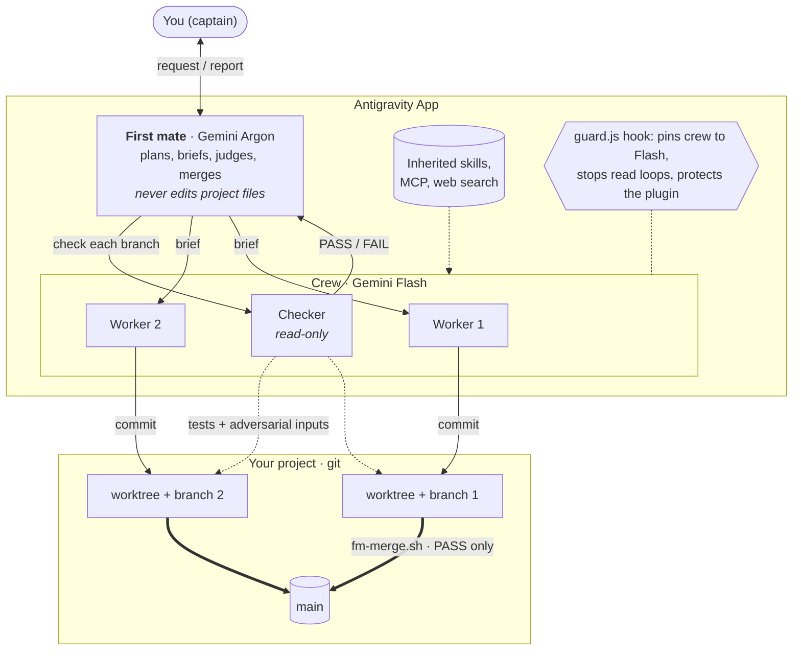
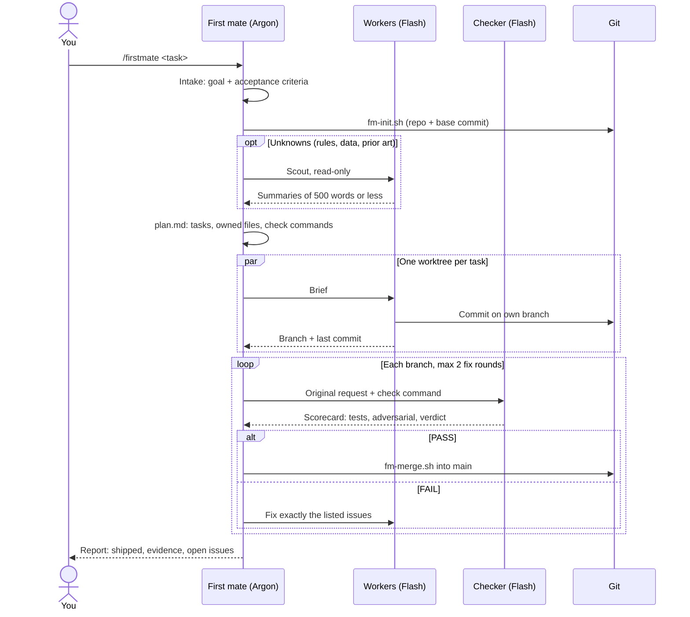
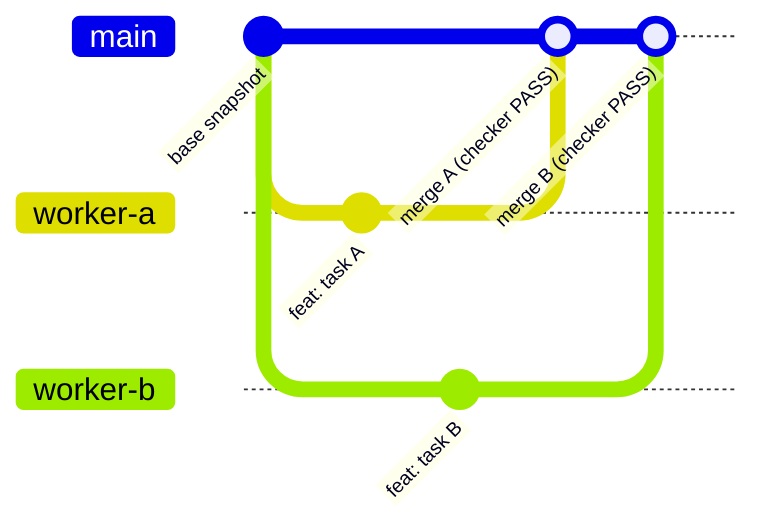
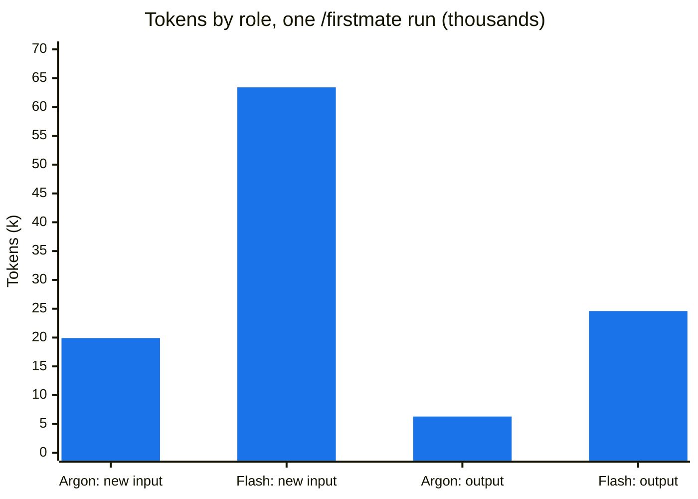

# Architecture

How the Firstmate Crew plugin is put together and what happens during a `/firstmate` run.

## Components

| Part | Model | Can edit the project? | Job |
|---|---|---|---|
| First mate (`agents/firstmate.md`) | Gemini Argon | No, only notes under `.firstmate/` | Turn the request into tasks, brief workers, judge checker scorecards, merge |
| Worker (`agents/worker.md`) | Gemini Flash | Yes, inside its own worktree only | Do one task, commit on its branch, report |
| Checker (`agents/checker.md`) | Gemini Flash | No | Compare a branch with the *original* request; run tests and adversarial inputs |
| `hooks/guard.js` | n/a | n/a | PreToolUse hook: forces `Model: "flash"` for worker/checker, denies repeated identical reads, denies edits to the plugin |
| `scripts/fm-*.sh` | n/a | n/a | Deterministic git steps, so Argon spends no tokens reasoning about them |

## One `/firstmate` run

Argon only reads short artifacts: worker summaries, checker scorecards, `git log`. Long reports stay in files under `.firstmate/`, which keeps the expensive model's input small.

## Git model

Every task gets its own worktree and branch, created by the App (`Workspace: "branch"`). Nothing reaches `main` without a passing checker scorecard.

- `fm-init.sh` creates the repo and the base commit. It also git-ignores data, virtual environments and `.firstmate/`.
- `fm-merge.sh` merges with `--no-ff`. On a conflict it aborts, leaves `main` unchanged and lists the conflicting files, and the first mate sends a worker to resolve them.
- The scripts always act on the main checkout, even if they are handed a worktree path.

## Where the tokens go

Measured on a single small run (`slugify` plus tests) on the author's machine. Treat it as an illustration, not a benchmark. Argon tokens cost more and count against a separate quota, so the share that matters is Argon's: about 24% of new input and 20% of output.

